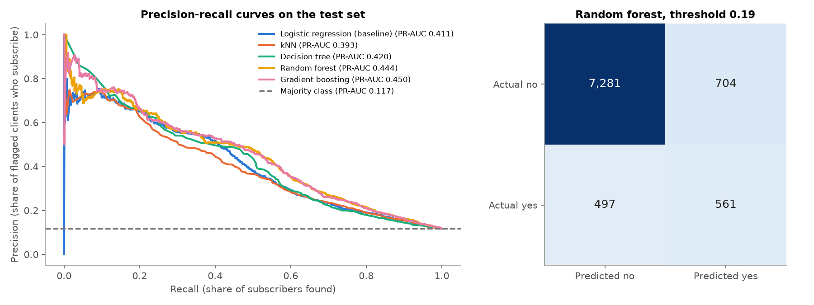
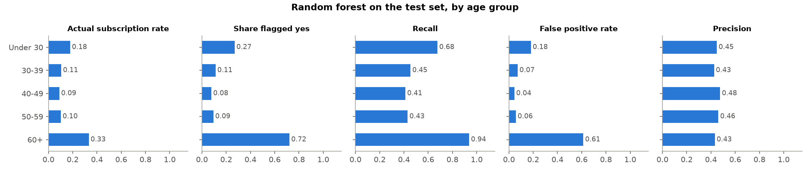
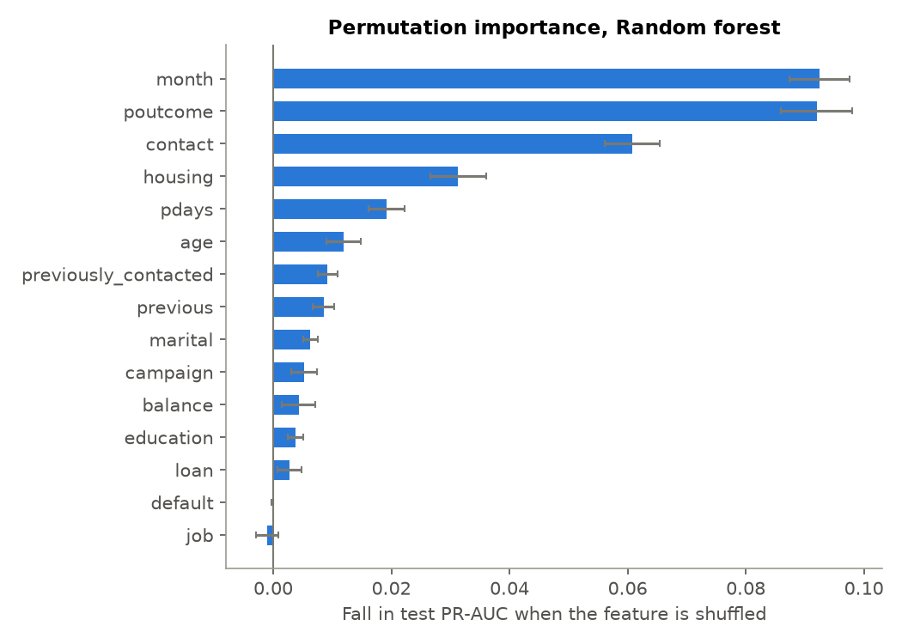

# Predicting Term-Deposit Subscription from Bank Telemarketing Data

CT4101 Machine Learning, Final Report
Robert Fitzgerald Bellone (10102634)
Repository: https://github.com/RobertFitzB/CT4101-ml-project

## 1. Problem

The purpose of this project is to find out whether a banking client's profile and contact history can predict if they will subscribe to a term deposit, using only information that is available before a call is made. It is a binary classification problem, with "yes" (subscribed) as the positive class.

Telemarketing campaigns are expensive and most calls are unsuccessful. In the data used here, only 11.7% of clients subscribed. A model that ranks clients by their likelihood of subscribing could help a bank focus its calls on the clients most likely to be interested, and make fewer calls to those who are not. This could lower the cost of a campaign and reduce the number of unwanted calls clients receive.

The intended use of the model is to support the people who plan a campaign. The model would rank clients for a call list, and staff would decide whom to call. It is not intended to decide on its own who is offered a financial product, and section 5 explains why I believe that boundary matters.

It is worth noting that the condition "before a call is made" shapes the whole project. Any feature that is only known once a call has started, or once it has ended, cannot be used, because it would not be available at the moment the model is needed. This rules out the call duration, which is the strongest predictor in the dataset (section 2). Including it would make the model look far better than it could ever be in practice.

I set three questions for the evaluation:

1. Does any learned model clearly beat a simple logistic regression baseline?
2. How well does the best model rank clients, and what does it mean in practice at a chosen decision threshold?
3. Does the model make errors evenly across age groups, given that the product is financial and some clients may be more vulnerable to sales pressure?

## 2. Data

I used the Bank Marketing dataset (bank-full) from the UCI Machine Learning Repository (Moro et al., 2014), released under CC BY 4.0. It records the direct marketing calls of a Portuguese bank between May 2008 and November 2010. There are 45,211 clients and 17 columns: 7 numeric features, 9 categorical features and the target `y`. The data is downloaded by a script in the repository and is not stored there.

The audit in notebook 01 found no `NaN` values. Instead, missing information is recorded as the string `unknown`. Not all cases of this could be treated in the same way however. In `poutcome`, `unknown` (81.7% of clients) lines up almost exactly with `pdays = -1`, so it means "no previous campaign" rather than missing data. In `contact` (28.8%), `education` (4.1%) and `job` (0.6%), I kept `unknown` as its own category, as there was no sensible value to impute and dropping rows would waste data.

I made four row-wise changes before modelling:

- **`duration` was dropped.** The length of a call is only known after it ends and strongly reveals the outcome, so keeping it would leak the answer.
- **`day` was dropped.** The day of the month has no plausible link to a client's decision. A check in notebook 01 showed that it only helped by combining with `month` to pick out specific calendar dates, which will not recur.
- **A `previously_contacted` flag was added**, and the `-1` code in `pdays` was replaced with 0, so that models do not read -1 as a real number of days.
- **The target was encoded** as 1 for "yes" and 0 for "no".

None of these steps learn from the data, so applying them before the split does not leak information.

Three numeric features have extreme values. `balance` runs from -8,019 to 102,127, `campaign` reaches 63 calls and `previous` reaches 275. These look like real but unusual values rather than errors, so I kept them. Numeric features are standardised for the models that are sensitive to scale.

Removing `duration` and `day` makes 132 rows identical to another row. With no client ID, I cannot tell whether these are the same client or not. I decided to keep these rows, but this is a minor limitation.

The most important property of the data is the imbalance. A baseline model that always predicts "no" would be 88.3% accurate while finding no subscribers, which is why accuracy is not a useful metric for this project at all.

## 3. Methods

**Evaluation design.** I held back a stratified 20% test set (9,043 clients) at the start, using `random_state=42`. All development, including tuning, balancing and threshold choices, used stratified 5-fold cross-validation on the remaining 36,168 clients. Scaling, any resampling and one-hot encoding sit inside a single `imblearn` `Pipeline` (Lemaitre et al., 2017), so in every fold they are fitted on the training portion only. The test set was opened once, at the end, after every setting had been fixed.

**Metrics.** PR-AUC (average precision) is my main metric, as it measures how well a model finds the rare positive class and is not flattered by the majority class. Its value for a random model equals the positive rate, 0.117. I also report ROC-AUC and F1, and precision and recall at the chosen threshold.

**Models.** I compared two baselines with four learned models:

| Model | Role | Tuned using |
|---|---|---|
| Majority class | Minimum any model must beat | n/a |
| Logistic regression | Simple learned baseline, default settings | n/a |
| kNN | Distance-based model | `n_neighbors`, `weights` |
| Decision tree | Single interpretable tree | `max_depth`, `min_samples_leaf` |
| Random forest | Bagged ensemble of 300 trees | `max_depth`, `min_samples_leaf` |
| Gradient boosting | Boosted ensemble (`HistGradientBoostingClassifier`) | `learning_rate`, `max_leaf_nodes`, `max_iter` |

Each grid was kept small on purpose and searched with `GridSearchCV` on the same five folds, keeping the setting with the highest PR-AUC.

**Data balancing.** Following the feedback I received on Milestone 2, I compared five ways of handling the imbalance for every model: no balancing, class weighting, random oversampling, random undersampling and SMOTE-NC (Chawla et al., 2002). I used SMOTE-NC rather than plain SMOTE because nine features are categorical, and interpolating between one-hot columns would create impossible clients. Each model was tuned separately under each technique, so that no technique was favoured by settings chosen for another.

No technique improved PR-AUC on average. Balancing raised F1 at the default 0.5 threshold considerably (from 0.281 to 0.440 for the random forest), but it did so by pushing every predicted probability upwards, from a mean of 0.117 to around 0.4. Once the threshold was tuned, the unbalanced models matched or beat the balanced ones. I can conclude that the imbalance affects the default decision rule rather than the ranking the models learn. I therefore handled it with stratified splits, PR-AUC as the main metric and a tuned threshold, which keeps the probabilities meaningful.

**Decision threshold.** For each model, the threshold is the value that maximises F1 on the pooled out-of-fold predictions of the training set. It was fixed before the test set was used.

**Final checks.** Before opening the test set, I checked the calibration of the three strongest models with reliability curves and the Brier score, and measured the effect of removing `age` and `month` on PR-AUC and on the age-group error rates. I decided in advance that I would only change the final model if removing a feature closed most of the age gap at a small cost to PR-AUC. The ablation did not meet that bar and the calibration needed no correction, so the final model was not changed.

**Test evaluation.** Every model was refitted on the full training set and scored once on the test set. Uncertainty is shown with 95% intervals from 1,000 bootstrap resamples of the test rows. Because the same resamples are used for every model, the difference between two models can be compared resample by resample. Finally, I measured permutation importance on the test set, on the original columns rather than the one-hot columns, with 10 repeats.

## 4. Results

**Model selection.** In cross-validation the random forest (PR-AUC 0.432) and gradient boosting (0.431) were the strongest models, followed by the logistic regression baseline (0.402), the decision tree (0.393) and kNN (0.384). The two ensembles could not be separated, as the sign of their gap changed from fold to fold. I carried the random forest forward as the highest-scoring model: 300 trees, `max_depth=14`, `min_samples_leaf=5`, no resampling and a threshold of 0.193.

Its probabilities are well calibrated. The mean predicted probability (0.117) matches the actual rate, and its Brier score (0.0834) is effectively tied with gradient boosting (0.0833) and slightly better than logistic regression (0.0863), so no calibration step was needed.

**Test results.** Figure 1 and the table below show the results on the held-out test set.

*Figure 1. Test-set PR-AUC with 95% bootstrap intervals.*

| Model | Test PR-AUC (95% CI) | CV PR-AUC | ROC-AUC | F1 |
|---|---|---|---|---|
| Majority class | 0.117 | 0.117 | 0.500 | 0.000 |
| Logistic regression | 0.411 (0.380 to 0.446) | 0.402 | 0.772 | 0.449 |
| kNN | 0.393 (0.362 to 0.426) | 0.384 | 0.767 | 0.422 |
| Decision tree | 0.420 (0.388 to 0.451) | 0.393 | 0.764 | 0.471 |
| **Random forest** | **0.444 (0.413 to 0.476)** | 0.432 | 0.797 | 0.483 |
| Gradient boosting | 0.450 (0.418 to 0.484) | 0.431 | 0.796 | 0.484 |

The random forest beats the logistic regression baseline by 0.033 PR-AUC, and it is ahead in all 1,000 resamples. I can conclude that it is a genuine improvement, which answers my first question. Gradient boosting scored slightly higher, but the gap between them (-0.016 to 0.004) includes zero, which matches cross-validation. The random forest remains my final model because it was chosen before the test set was opened, and choosing again now would mean selecting on the test set.

Accross the board, the learned models scored slightly higher on the test set than in cross-validation. The final models were trained on all of the training data rather than 80% of it, and the order of the models barely changed, which may indicate that model selection did not overfit the folds.

**Decisions in practice.** At the threshold of 0.193, the random forest finds 561 of the 1,058 subscribers in the test set (recall 0.530) with a precision of 0.443. It makes 704 unnecessary calls and misses 497 subscribers. Seen as a call budget, calling the 20% of clients ranked highest would reach 60.0% of all subscribers with a precision of 0.351, three times the rate of calling at random.

**Error analysis.** The cross-validation error analysis in notebook 02 found that recall is lowest for clients with no previous campaign (0.343), who account for 88% of missed subscribers. Recall is also very low where `contact` is `unknown`, and 96% of those clients were called in May or June, which may indicate a period when the bank did not record contact type. In March and October, the model flags almost everybody.

**Age-group fairness.** Figure 2 shows the error rates by age group on the test set.

*Figure 2. Test-set subscription rate, flagged rate and error rates of the random forest by age group.*

Precision is fairly even across groups (0.426 to 0.475), so a flagged client is about as likely to subscribe regardless of age. The other error rates are not even. Clients aged 60 and over have a false positive rate of 0.613 (0.546 to 0.677), against 0.045 to 0.072 for clients aged 30 to 59. The model flags 72.1% of older clients, more than twice their subscription rate of 33.2%. The intervals are far apart, so this is not explained by the small size of the group (337 clients).

Removing `age` in cross-validation cost only 0.002 PR-AUC, and it lowered the false positive rate for this group from 0.616 to 0.438, which is still far above the rate for middle-aged clients. Other features, such as being retired and being called in the quieter months, carry much of the same information.

**Interpretability.** Figure 3 shows the permutation importance of each feature.

*Figure 3. Fall in test PR-AUC when each feature is shuffled (10 repeats).*

The model relies most on `month` (0.093) and `poutcome` (0.092), followed by `contact` (0.061) and `housing` (0.031). Two of the three most important features describe how and when the bank ran its campaigns rather than the client. Removing `month` lowered PR-AUC by 0.036 in all five folds. It is worth noting that these importances describe what the model uses, and do not show that calling in a particular month would cause a client to subscribe.

## 5. Limitations and responsible use

**Unequal errors by age.** The most serious risk is the one shown in Figure 2. A bank using this model as it stands would make many unsuccessful calls to clients aged 60 and over. As a term deposit is a financial product, this risks placing unwanted sales pressure on a group that may be more vulnerable to it. Removing `age` does not solve the problem, because other features stand in for it, so I do not believe a technical fix alone is enough.

**Dependence on campaign timing.** `month` and `contact` are among the most important features, and both appear to reflect how the 2008 to 2010 campaigns were run. The split is random rather than by date, so the test set is not truly future data. The model may perform worse on a new campaign run in a different way, and a random split cannot show this.

**Clients with no history.** The model finds few subscribers among clients with no previous campaign, who make up most of the client base. Its value is concentrated among clients the bank already knows.

**The threshold is an assumption.** Maximising F1 treats a missed subscriber and an unnecessary call as equally costly. A bank would set the threshold from the cost of a call and the value of a subscription, neither of which I have.

**Smaller points.** The 132 duplicate rows could appear on both sides of the split, and the data comes from one bank in one country more than fifteen years ago, so it may not represent clients today.

Given these risks, I propose the following conditions for any use of the model:

- it ranks clients for a call list, and does not decide automatically whom to call;
- staff review the calls to clients aged 60 and over;
- error rates are monitored by age group and by month during use;
- wider use depends on a limited pilot showing that the model holds up on a new campaign.

## 6. Conclusion

I can conclude that a client's profile and contact history can predict term-deposit subscription with useful, though limited, accuracy. The final random forest reaches a test PR-AUC of 0.444, almost four times the rate of random calling and a clear improvement on the logistic regression baseline. Its probabilities are well calibrated, and its test results agree with cross-validation.

The most important lesson for me was that the strongest results came from careful evaluation decisions rather than from model complexity. Dropping `duration`, testing balancing properly and keeping the test set untouched until the end all made the results more trustworthy, while the more complex models only added about 0.03 PR-AUC.

The model is not ready for automatic use, mainly because of its uneven errors across age groups and its dependence on campaign timing. Future work should be done to evaluate it on a later time period, set the threshold from real costs and investigate how to reduce the over-flagging of older clients. With those steps, I believe it could become a useful tool for planning a campaign alongside human oversight.

## References

Chawla, N. V., Bowyer, K. W., Hall, L. O., & Kegelmeyer, W. P. (2002). SMOTE: Synthetic Minority Over-sampling Technique. *Journal of Artificial Intelligence Research, 16*, 321-357.

Lemaitre, G., Nogueira, F., & Aridas, C. K. (2017). Imbalanced-learn: A Python Toolbox to Tackle the Curse of Imbalanced Datasets in Machine Learning. *Journal of Machine Learning Research, 18*(17), 1-5.

Moro, S., Rita, P., & Cortez, P. (2014). *Bank Marketing* [Dataset]. UCI Machine Learning Repository. https://doi.org/10.24432/C5K306
